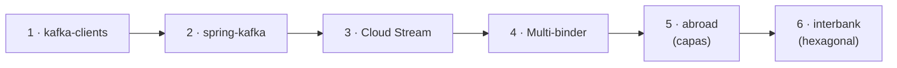

# kafka-streaming-lab

Monorepo con los ejemplos y proyectos que he construido con **Apache Kafka**: desde el cliente nativo hasta microservicios orientados a eventos con **Spring Cloud Stream** sobre **Azure Event Hubs** (protocolo Kafka).

## Índice de proyectos

| # | Proyecto | Tipo | Qué demuestra de Kafka | Arquitectura |
|---|---|---|---|---|
| 1 | [`kafka/`](kafka) | PoC | Productor y consumidor con `kafka-clients`: key, partición, grupo, offsets | **Ninguna** (dos clases con `main`): ver el cliente nativo sin framework |
| 2 | [`apache-kafka/spring-kafka-simple/`](apache-kafka/spring-kafka-simple) | PoC | `KafkaTemplate`, `@KafkaListener`, topics por código, REST que publica | **Mínima**: `config`, `controller` y `listeners` en un solo paquete |
| 3 | [`apache-kafka/spring-Kafka-cloud-stream/`](apache-kafka/spring-Kafka-cloud-stream) | PoC | `Consumer` como bean, `StreamBridge`, Event Hubs | **Servicios + bridge**: `ProduceEvents`, `ConsumeEvents` y `Bridge` |
| 4 | [`apache-kafka/spring-kafka-cloud-stream-multi-binder/`](apache-kafka/spring-kafka-cloud-stream-multi-binder) | PoC | Multi-binder, headers de trazabilidad, envelope CloudEvents, WebFlux | **Por capas ligera**: `controller` → `service` → `stream`, con un `domain` de mensajes y excepciones |
| 5 | [`async-abroad-transfer-order/`](async-abroad-transfer-order) | Microservicio | Consumidor de un tópico con dos tipos de evento, tareas programadas, ejecución con y sin exención | **En capas**: entrada de stream → servicio de orquestación → clientes OpenAPI. Candidato a migrar a hexagonal |
| 6 | [`async-interbank-transfer/`](async-interbank-transfer) | Microservicio | Consumidor con reintento escalonado republicando en el mismo tópico, trazabilidad por *headers*, aviso por Redis | **Hexagonal (puertos y adaptadores)**: migración desde capas en curso en la rama `feature/interbank-hexagonal` |

Documentación complementaria:

| Documento | Contenido |
|---|---|
| [`case-studies/async-interbank-transfer.md`](case-studies/async-interbank-transfer.md) | Cómo se diseñó el caso interbancario y los problemas que resolvió |
| [`case-studies/async-abroad-transfer-order.md`](case-studies/async-abroad-transfer-order.md) | Cómo se diseñó el caso de transferencias al exterior |
| [`docs/gestion-de-claves.md`](docs/gestion-de-claves.md) | Configuración sin secretos, mínimo privilegio y respuesta ante una filtración |

## Cómo leerlo

De menos a más abstracción y de menos a más arquitectura: primero el cliente puro, después Spring, después Cloud Stream, y por último dos microservicios reales, el segundo reestructurado como **puertos y adaptadores**.

## Qué demuestra cada tecnología

| Tema | Proyectos |
|---|---|
| Productor, consumidor, key, partición, offset, grupo | 1 |
| `KafkaTemplate` y `@KafkaListener` | 2 |
| Spring Cloud Stream funcional (`Consumer<Message<String>>`, `StreamBridge`) | 3, 4, 5, 6 |
| Varios binders en una aplicación | 4 |
| Kafka sobre Azure Event Hubs (`SASL_SSL` + `PLAIN`) | 3, 4, 5, 6 |
| Headers de trazabilidad (`request-id`, `process-code`, `x-session`...) | 4, 5, 6 |
| Reactivo (WebFlux / Reactor) con mensajería | 4, 5, 6 |
| Reintentos y manejo de errores en consumidores | 5, 6 |
| Arquitectura hexagonal (puertos y adaptadores) | 6 |
| Clientes HTTP generados desde OpenAPI | 5, 6 |

## Seguridad y configuración

- Ningún secreto se versiona (ver [Gestión de claves](docs/gestion-de-claves.md)). Las claves de acceso, hosts internos y contraseñas se sustituyen por variables de entorno (`EVENTHUB_HOST`, `EVENTHUB_SHARED_ACCESS_KEY`, `REDIS_PASSWORD`, ...).
- Los archivos `application-local.*` están en el [`.gitignore`](.gitignore); en su lugar se versionan plantillas `*.example`.
- `build/`, `.gradle/`, `.idea/` y los `.jar` no se versionan.
- Las claves que alguna vez estuvieron en texto plano deben considerarse comprometidas y **rotarse** en el proveedor.

## Estado de los proyectos

Varios proyectos no incluyen `build.gradle`/`settings.gradle` en el árbol; cada README indica las dependencias inferidas. El proyecto 6 llevará su propio build reconstruido.

## Estudio relacionado

- [Kafka a fondo](https://github.com/edzamo/software-engineering/blob/main/messaging-streaming/kafka.md)
- [SmallRye Reactive Messaging (Quarkus)](https://github.com/edzamo/software-engineering/blob/main/frameworks/quarkus/smallrye-reactive-messaging.md)
- [Kafka vs RabbitMQ vs colas gestionadas](https://github.com/edzamo/software-engineering/blob/main/messaging-streaming/README.md)
