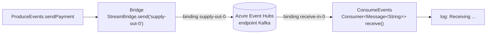

# Ejercicio 3 · Spring Cloud Stream con Kafka (modelo funcional)

> **Arquitectura:** servicios + bridge. `ProduceEvents` y `ConsumeEvents` usan Spring Cloud Stream, y `Bridge` encapsula `StreamBridge`. Sin dominio propio. **Índice:** [volver al monorepo](../../README.md).

Mensajería con **Spring Cloud Stream**: en lugar de usar `KafkaTemplate` y `@KafkaListener`, declaras **funciones** (`Consumer<...>`) y **bindings** en la configuración, y el framework conecta cada función con el broker. Aquí el broker es el **endpoint compatible con Kafka de Azure Event Hubs**.

| | |
|---|---|
| **Stack** | Spring Boot 3.2.5, Spring Cloud Stream 4.1.1 (binder Kafka), `spring-kafka` 3.1.4, `kafka-clients` 3.6.2, WebFlux, Lombok, Gradle 8.7 |
| **Broker** | Azure Event Hubs por el protocolo Kafka (puerto 9093, SASL_SSL) |
| **Clases clave** | [`ConsumeEvents`](src/main/java/com/example/kafkacloudstream/service/ConsumeEvents.java), [`ProduceEvents`](src/main/java/com/example/kafkacloudstream/service/ProduceEvents.java), [`Bridge`](src/main/java/com/example/kafkacloudstream/service/stream/Bridge.java) |

> **Estado del árbol local:** falta el `build.gradle` y `application.yml`; la clase principal y el controlador existen compilados en `build/` pero no en `src/`. Las credenciales ya fueron sustituidas por variables de entorno (ver Seguridad).

## 🍎 Con manzanas

En el ejercicio anterior hablabas directamente con el libro de ventas. Aquí pones **cintas transportadoras con nombre** (los *bindings*): una cinta de salida (`supply-out-0`) por donde la caja deja las notas, y una cinta de entrada (`receive-in-0`) que lleva las notas hasta el empleado que las lee (`receive`). **Un archivo de configuración** dice a qué libro de Kafka conecta cada cinta. Tú solo escribes qué hacer con cada nota.

## Qué hace

| Pieza | Qué hace |
|---|---|
| `ConsumeEvents` | Declara un bean `Consumer<Message<String>> receive()`: **ese bean es el consumidor**; su nombre define el binding `receive-in-0` |
| `Bridge` | Usa `StreamBridge.send("supply-out-0", obj)` para **publicar desde código imperativo** |
| `ProduceEvents` | Servicio que delega en `Bridge` |
| Configuración (en el jar) | Puerto, brokers del Event Hub, `security.protocol=SASL_SSL`, `sasl.mechanism=PLAIN`, bindings `receive-in-0` y `supply-out-0` hacia el mismo destino, `spring.cloud.function.definition=receive` |

## Conceptos que demuestra

| Concepto | Dónde se ve |
|---|---|
| **Modelo funcional** | `Consumer<Message<String>>` como bean: no hay `@KafkaListener` |
| **Convención de nombres de binding** | `<función>-in-<n>` y `<función>-out-<n>` (`receive-in-0`, `supply-out-0`) |
| **`spring.cloud.function.definition`** | Lista qué funciones se activan |
| **`StreamBridge`** | Publicar mensajes desde un servicio o controlador, fuera de una función |
| **Abstracción del broker** | El mismo código serviría con Kafka, RabbitMQ u otro *binder* |
| **Event Hubs con protocolo Kafka** | Se conecta cambiando `brokers` y la autenticación `SASL_SSL` con `$ConnectionString` como usuario |
| **`Message<T>` con headers** | El consumidor recibe payload y cabeceras |

## Cómo ejecutarlo

1. Un Event Hub (o un Kafka local) y su cadena de conexión **en una variable de entorno**, nunca en el archivo.
2. Definir un `application.yml` con los brokers, la seguridad y los bindings.
3. `./gradlew bootRun`.

## Observaciones para revisar

| Observación | Por qué importa | Corrección |
|---|---|---|
| El binding de salida se llama `supply-out-0` pero **no existe una función `supply`** | Funciona porque `StreamBridge` crea el binding dinámicamente; el nombre induce a confusión | Nombrarlo por su propósito (`payment-out-0`), como en el ejercicio 4 |
| Los dos bindings (`receive-in-0` y `supply-out-0`) apuntan al **mismo destino** | Bueno para una prueba: lo que envías, lo recibes | En un caso real cada flujo tendría su destino y su grupo |
| Sin `group` definido en el binding | Spring genera un grupo anónimo por instancia: cada instancia recibe todos los mensajes | Definir `spring.cloud.stream.bindings.receive-in-0.group` |
| Sin manejo de errores ni DLQ | Un mensaje con error se reintenta y luego se pierde | `consumer.max-attempts`, `enableDlq` y `dlqName` del binder Kafka |
| La cadena de conexión estaba en el archivo de configuración | **Riesgo de seguridad** | Ya sustituida por variable de entorno; ver Seguridad |

## Seguridad: credenciales

La cadena de conexión de Event Hubs se **sacó** de los archivos y del `.jar` compilado (ahora usa `${EVENTHUB_SHARED_ACCESS_KEY}` y `${EVENTHUB_HOST}`). Las claves anteriores estuvieron en texto plano: **hay que rotarlas en Azure**. `build/` y los `application-local.*` están en el [`.gitignore`](../../.gitignore) de la raíz. Para ejecutarlo, definir esas variables de entorno.

## Cómo explicarlo en una entrevista

> "Probé Spring Cloud Stream con el modelo funcional: declaras un `Consumer<Message<String>>` como bean y lo enlazas a un destino por configuración, y para publicar desde código uso `StreamBridge`. Lo conecté a Azure Event Hubs usando su endpoint compatible con Kafka, con `SASL_SSL`. Es el equivalente en Spring de los canales `@Incoming` y el `Emitter` de SmallRye Reactive Messaging en Quarkus."

## Equivalencia con Quarkus (SmallRye)

| Spring Cloud Stream | SmallRye Reactive Messaging |
|---|---|
| Binding (`receive-in-0`) | Canal (`@Incoming("receive")`) |
| `Consumer<Message<String>>` como bean | Método con `@Incoming` |
| `StreamBridge.send` | `Emitter.send` |
| Binder (`kafka`) | Conector (`smallrye-kafka`) |
| `spring.cloud.stream.bindings.*` | `mp.messaging.incoming.*` / `outgoing.*` |

## Relacionado en el repo de estudio

[`SmallRye Reactive Messaging`](https://github.com/edzamo/software-engineering/blob/main/frameworks/quarkus/smallrye-reactive-messaging.md) · [`kafka.md`](https://github.com/edzamo/software-engineering/blob/main/messaging-streaming/kafka.md)
