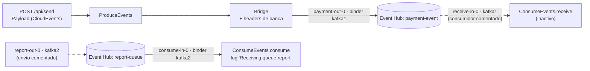

# Ejercicio 4 · Spring Cloud Stream con **varios binders** (Azure Event Hubs por protocolo Kafka)

La prueba de concepto más completa: una API REST que recibe un evento de **pago de archivos** (con formato CloudEvents), lo publica con **cabeceras de banca** a un Event Hub, y consume otro canal de **reportes** desde un segundo Event Hub. Lo central es el **multi-binder**: dos conexiones distintas al mismo servicio en una sola aplicación.

| | |
|---|---|
| **Stack** | Spring Boot (WebFlux), Spring Cloud Stream (binder Kafka), Lombok, Gradle 8.7 |
| **Broker** | Azure Event Hubs por protocolo Kafka (puerto 9093, SASL_SSL) |
| **Endpoint** | `POST /api/send` con un `Payload` JSON |
| **Configuración** | [`application-local.yml`](src/main/resources/application-local.yml) (perfil `local`, puerto 9080) |
| **Clases clave** | [`SendMessageController`](src/main/java/com/example/kafkacloudstream/controller/SendMessageController.java), [`Bridge`](src/main/java/com/example/kafkacloudstream/service/stream/Bridge.java), [`ConsumeEvents`](src/main/java/com/example/kafkacloudstream/service/ConsumeEvents.java), [`domain/message/`](src/main/java/com/example/kafkacloudstream/domain/message) |

> **Estado del árbol local:** falta el `build.gradle`. Las credenciales ya fueron sustituidas por variables de entorno (ver Seguridad).

## 🍎 Con manzanas

La frutería ahora trabaja con **dos proveedores** (dos Event Hubs) y cada uno te da **su propia llave** (cadena de conexión). Un solo empleado no puede usar dos llaves a la vez, así que tienes **dos empleados de enlace**: `kafka1` (el de **pagos**) y `kafka2` (el de **reportes**). Cada cinta transportadora (binding) dice con cuál de los dos empleados habla. Al enviar una nota, la caja le pega **etiquetas** (headers) con quién la mandó, desde qué canal y con qué número de seguimiento.

## Qué hace

| Pieza | Qué hace |
|---|---|
| `SendMessageController` | `POST /api/send`: recibe un `Payload` y devuelve `Mono<ResponseEntity<String>>` (WebFlux) |
| `ProduceEvents` → `Bridge` | Publica con `StreamBridge.send("payment-out-0", message)` |
| `Bridge` | Construye un `Message<Payload>` y le copia **15 cabeceras** (`app-name`, `caller-name`, `process-code`, `x-session`, `x-device`, `x-device-ip`, `x-language`, `x-guid`, `x-channel`, `x-medium`, `x-app`, ids de cliente...) |
| `ConsumeEvents.consume` | `Consumer<Message<String>>` que registra lo recibido del canal de reportes |
| `domain/message` | El modelo `Payload` (sobre CloudEvents) → `Data` (evento de almacenamiento de archivo) → `Status`, `StorageDiagnostics` |
| `domain/catalog`, `domain/enums`, `domain/exception` | Catálogos, enums y excepciones del dominio (no revisados en detalle) |
| `application-local.yml` | Dos *binders* (`kafka1`, `kafka2`) y cuatro *bindings* (`payment-out-0`, `receive-in-0`, `report-out-0`, `consume-in-0`) |

### El modelo del mensaje

Un `Payload` sigue la forma de **CloudEvents** (`specversion`, `type`, `source`, `id`, `time`, `subject`, `data`). El campo `data` recuerda a un **evento de creación de un archivo en un almacenamiento** (`api`, `url`, `eTag`, `contentType`, `blobType`, `sequencer`, `storageDiagnostics`) con campos de negocio añadidos (`referenceId`, `originFileName`, `hash`, `channel`, `product`, `status`). Es un flujo de **archivos de pago**: llega un archivo, se publica el evento y otro proceso lo procesa y publica un reporte.

## Conceptos que demuestra

| Concepto | Dónde se ve |
|---|---|
| **Multi-binder** | `binders: kafka1` y `kafka2`, cada uno con **su propia cadena de conexión**: en Event Hubs cada hub tiene su política de acceso |
| **Binding a un binder concreto** | `binder: kafka1` / `binder: kafka2` en cada binding |
| **Event Hubs con protocolo Kafka** | `security.protocol=SASL_SSL`, `sasl.mechanism=PLAIN`, usuario `$ConnectionString` |
| **Headers como metadatos de banca** | `Bridge` copia cabeceras de canal, dispositivo, sesión y trazabilidad al mensaje |
| **Envelope CloudEvents** | `Payload` con `specversion`, `type`, `source`... |
| **StreamBridge** | Publicar desde un servicio |
| **WebFlux + mensajería** | Controlador reactivo que dispara el envío |
| **Perfiles** | `application-local.yml` |

## Observaciones para revisar

| Observación | Por qué importa | Corrección |
|---|---|---|
| El controlador responde `"hola"` con 200 sin esperar el resultado del envío | El cliente cree que se publicó aunque falle | Esperar el resultado de `StreamBridge.send` (devuelve `boolean`) y responder `202 Accepted` o un error |
| `StreamBridge.send` es **bloqueante** y se llama dentro de un `Mono` sin `subscribeOn` | En WebFlux puede **bloquear el event loop** | Ejecutarlo en `Schedulers.boundedElastic()` o usar un publicador reactivo |
| Los headers se **fijan en el código** (`x-session`, `request-date`, ids) | Para una prueba sirve; en un caso real se pierde la trazabilidad | Tomarlos del request entrante o generarlos (`correlation-id`, `traceparent`) |
| `spring.cloud.function.definition: consume` activa solo esa función | El consumidor `receive` está comentado; el binding `receive-in-0` queda sin función | Alinear los bindings con las funciones activas (`receive;consume`) |
| Sin `group` en los bindings de entrada | Grupo anónimo por instancia | Definir `group` en cada binding |
| Sin manejo de errores ni DLQ | Un mensaje con error se reintenta y se pierde | `max-attempts`, `enableDlq` y alarma sobre la DLQ |
| Sin clave de partición | Los mensajes no tienen orden por entidad | `partitionKeyExpression` (por ejemplo `payload.data.referenceId`) |

## Seguridad: credenciales

Las claves y el *namespace* de Event Hubs se **sacaron** de `application-local.yml` (ahora usa `${EVENTHUB_SHARED_ACCESS_KEY}`, `${EVENTHUB_HOST}`, `${EVENTHUB_PAYMENT_KEY_NAME}` y `${EVENTHUB_REPORT_KEY_NAME}`). Las claves anteriores estuvieron en texto plano: **hay que rotarlas en Azure**. El archivo real está en el [`.gitignore`](../../.gitignore) y se versiona solo [`application-local.yml.example`](src/main/resources/application-local.yml.example). Preferir Microsoft Entra ID / identidades administradas y una política `Send` o `Listen` por hub.

## Cómo ejecutarlo

1. Reponer el `build.gradle` (Spring Boot WebFlux, Spring Cloud Stream con el binder Kafka, Lombok).
2. Definir las cadenas de conexión por variable de entorno.
3. `./gradlew bootRun --args='--spring.profiles.active=local'` (puerto 9080).
4. Enviar un evento: `POST http://localhost:9080/api/send` con un JSON de `Payload`.

## Cómo explicarlo en una entrevista

> "Hice una prueba de concepto con Spring Cloud Stream conectada a **Azure Event Hubs por su endpoint de Kafka**. Como cada Event Hub tiene su propia política de acceso, configuré **dos binders** con distintas cadenas de conexión y enlacé cada binding al binder correspondiente. El API recibía un evento de pago de archivos en formato CloudEvents y lo publicaba con cabeceras de banca para trazabilidad; en otro canal consumía los reportes. Aprendí que hay que cuidar tres cosas: no bloquear el event loop de WebFlux al publicar, definir grupo y DLQ en los consumidores, y **no dejar credenciales en el repositorio**."

Esta experiencia te sirve para **tres preguntas**: *Kafka con Azure* (Event Hubs), *equivalente de SmallRye en Spring* (Cloud Stream) y *seguridad de secretos*.

## Equivalencia con Quarkus (SmallRye)

| Spring Cloud Stream (aquí) | SmallRye Reactive Messaging |
|---|---|
| Dos binders (`kafka1`, `kafka2`) | Dos conectores o canales con distinta configuración (`mp.messaging.incoming.x.*`) |
| Binding `payment-out-0` | Canal `payment` con `@Channel` y `Emitter` |
| `StreamBridge.send` | `Emitter.send` |
| `Consumer<Message<String>>` | `@Incoming("canal")` con `Message<String>` |
| Headers copiados con `MessageBuilder` | `OutgoingKafkaRecordMetadata` con `withHeaders` |

## Relacionado en el repo de estudio

[`SmallRye Reactive Messaging`](https://github.com/edzamo/software-engineering/blob/main/frameworks/quarkus/smallrye-reactive-messaging.md) · [`kafka.md`](https://github.com/edzamo/software-engineering/blob/main/messaging-streaming/kafka.md) (headers y banca) · [`caso-pasarela-pagos-cloud.md`](https://github.com/edzamo/software-engineering/blob/main/system-design/caso-pasarela-pagos-cloud.md) (Event Hubs en Azure)
