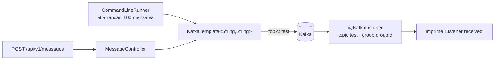

# Ejercicio 2 · Spring Kafka simple (`KafkaTemplate` + `@KafkaListener`)

> **Arquitectura:** mínima, un solo paquete con `config` (productor, consumidor, topics), `MessageController` (REST) y `KafkaListeners`. Sin capa de dominio. **Índice:** [volver al monorepo](../../README.md).

Kafka con **Spring Boot y `spring-kafka`**: un endpoint REST que publica mensajes, un listener que los consume y la configuración explícita de productor, consumidor y topic.

| | |
|---|---|
| **Stack** | Spring Boot, `spring-kafka`, Gradle 7.4.1, Java con `record` (16 o superior) |
| **Topics** | `test` (mensajes), `test10` (creado por configuración) |
| **Endpoint** | `POST /api/v1/messages` con `{"message": "..."}` |
| **Clases clave** | [`KafkaListeners`](src/main/java/ec/com/example/demoKafka/KafkaListeners.java), [`MessageController`](src/main/java/ec/com/example/demoKafka/MessageController.java), [`config/`](src/main/java/ec/com/example/demoKafka/config) |

> **Estado del árbol local:** en esta carpeta faltan `build.gradle`, `settings.gradle` y el `application.properties` (el código lee `spring.kafka.bootstrap-servers`). Para ejecutarlo hay que reponerlos.

## 🍎 Con manzanas

La frutería ya tiene su **libro de ventas** (Kafka). Aquí la **caja** (`KafkaTemplate`) anota ventas en el libro, ya sea por una **ventanilla web** (el endpoint REST) o automáticamente al abrir la tienda (100 ventas de prueba). Un **empleado de contabilidad** (`@KafkaListener`) está siempre mirando el libro y, cuando aparece una línea nueva, la lee y la imprime.

## Qué hace

| Pieza | Qué hace |
|---|---|
| `DemoKafkaApplication` | Un `CommandLineRunner` que envía 100 mensajes `Hello World :)i` al topic `test` al arrancar |
| `MessageController` | `POST /api/v1/messages`: recibe un `MessageRequest` y lo publica en `test` |
| `MessageRequest` | `record` con el campo `message` |
| `KafkaListeners` | `@KafkaListener(topics = "test", groupId = "groupId")`: imprime lo que llega |
| `KafkaProducerConfig` | `ProducerFactory` y `KafkaTemplate` con `StringSerializer` para key y value |
| `KafkaConsumerConfig` | `ConsumerFactory` y `ConcurrentKafkaListenerContainerFactory` |
| `KafkaTopicConfig` | Un `NewTopic` llamado `test10` con `TopicBuilder` |

## Conceptos que demuestra

| Concepto | Dónde se ve |
|---|---|
| **Productor con Spring** | `KafkaTemplate.send(topic, valor)` |
| **Consumidor declarativo** | `@KafkaListener` |
| **Configuración explícita** | Las clases `*Config` en lugar de solo `application.properties` |
| **Creación de topics por código** | `TopicBuilder` + `NewTopic` |
| **Mensajes por REST hacia Kafka** | El controlador es un **adaptador de entrada** que publica a un puerto de salida (`KafkaTemplate`) |

## Observaciones para revisar (útiles para explicar criterio)

No ejecuté el proyecto; esto sale de leer el código.

| Observación | Por qué importa | Corrección |
|---|---|---|
| `KafkaConsumerConfig` usa `StringSerializer` como **deserializador** de key y value | Es un clase de **serialización**, no de deserialización; el consumidor normalmente falla al crearse con un error de configuración | Usar `StringDeserializer` |
| El topic creado es `test10`, pero el productor y el listener usan `test` | `test` solo existirá si el broker **crea topics automáticamente**; en producción eso suele estar desactivado | Declarar el `NewTopic` con el nombre que realmente se usa, y con particiones y réplicas explícitas |
| Sin `auto.offset.reset` y con un grupo nuevo | El valor por defecto es `latest`: los 100 mensajes enviados **antes** de que el listener tenga particiones asignadas pueden **no leerse** | `earliest` si se quieren leer todos, o esperar a la asignación |
| La `factory` personalizada no se referencia desde `@KafkaListener` | Se usa la fábrica por defecto de Spring Boot (que sí toma el `ConsumerFactory` definido aquí) | Nombrarla `kafkaListenerContainerFactory` o indicarla en `containerFactory` |
| `send(...)` es asíncrono y no se revisa el resultado | Un fallo de envío pasa desapercibido | Usar el `CompletableFuture` que devuelve `send` y manejar el error |
| El listener recibe solo el `String` | No ve key, partición ni offset | `ConsumerRecord<String,String>` o `@Header` |
| Sin manejo de errores ni DLT | Un mensaje que falla se reintenta y luego se pierde | `DefaultErrorHandler` + `DeadLetterPublishingRecoverer` |

## Cómo ejecutarlo

1. Kafka en `localhost:9092`.
2. `application.properties` con `spring.kafka.bootstrap-servers=localhost:9092`.
3. `./gradlew bootRun`.
4. Publicar: `curl -X POST localhost:8080/api/v1/messages -H 'Content-Type: application/json' -d '{"message":"hola"}'`.

## Cómo explicarlo en una entrevista

> "Con `spring-kafka` usé `KafkaTemplate` para publicar y `@KafkaListener` para consumir, con las factories configuradas por código y un endpoint REST que publica mensajes. Es el equivalente en Spring de lo que en Quarkus hace SmallRye Reactive Messaging con `Emitter` e `@Incoming`."

## Equivalencia con Quarkus (SmallRye)

| Este ejercicio (Spring) | Quarkus (SmallRye) |
|---|---|
| `KafkaTemplate.send` | `Emitter.send` |
| `@KafkaListener(topics = ...)` | `@Incoming("canal")` |
| `ProducerFactory` / `ConsumerFactory` | `mp.messaging.*` en `application.properties` |
| `NewTopic` | Dev Services o el administrador del cluster |

## Relacionado en el repo de estudio

[`SmallRye Reactive Messaging`](https://github.com/edzamo/software-engineering/blob/main/frameworks/quarkus/smallrye-reactive-messaging.md) · [`kafka.md`](https://github.com/edzamo/software-engineering/blob/main/messaging-streaming/kafka.md)
