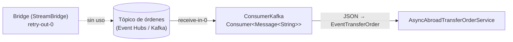
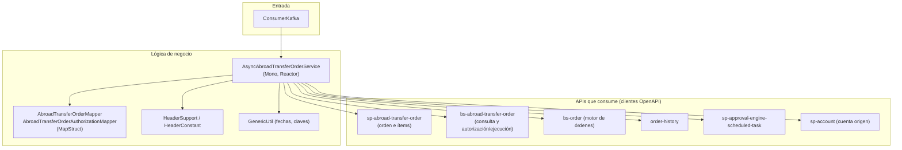
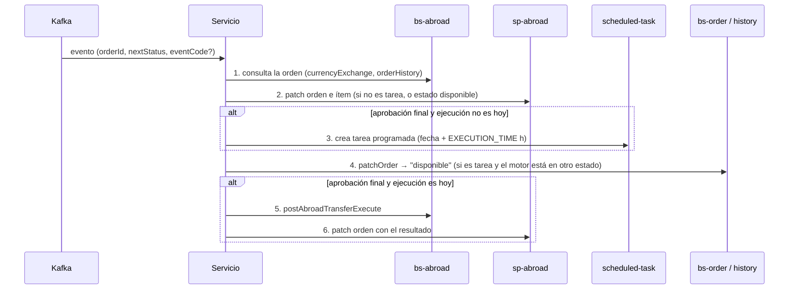

# async-abroad-transfer-order

Microservicio **consumidor de eventos** que procesa de forma asíncrona las **órdenes de transferencia al exterior** de una banca empresarial: actualiza el estado de la orden, programa tareas para órdenes con fecha futura y, cuando corresponde, **ejecuta la transferencia** (con o sin exención de impuesto).

| | |
|---|---|
| **Stack** | Java, Spring Boot (WebFlux / Reactor), Spring Cloud Stream (binder Kafka), MapStruct, Lombok, clientes generados desde OpenAPI, Gradle |
| **Broker** | Azure Event Hubs con protocolo Kafka (`SASL_SSL`, `PLAIN`, puerto 9093) |
| **Rol en Kafka** | Consumidor del tópico de órdenes. Tiene un `Bridge` de productor, pero **no se usa** en el servicio |
| **Tests** | JUnit 5 + Mockito en `src/test` (consumidor, servicio, manejo de errores, headers, utilidades) |

> Falta el `build.gradle`/`settings.gradle` en el árbol local. Las dependencias están inferidas del código.

## Qué hace sobre Kafka

| Elemento | Detalle |
|---|---|
| **Consumidor** | Bean `Consumer<Message<String>> receive()` en [`ConsumerKafka`](src/main/java/com/example/banking/services/service/stream/ConsumerKafka.java), activado con `spring.cloud.function.definition=receive` |
| **Productor** | [`Bridge`](src/main/java/com/example/banking/services/service/stream/Bridge.java) con `StreamBridge.send("retry-out-0", ...)`. Existe pero el servicio no lo invoca |
| **Payload** | JSON deserializado con Gson a [`EventTransferOrder`](src/main/java/com/example/banking/services/dto/EventTransferOrder.java): `orderId`, `customerUserId`, `eventDate`, `nextStatus`, `channel`, `action`, `orderType`, `expirationDate`, `eventCode`, `segIntervalError` |
| **Reintentos del binder** | `maxAttempts=3`, `backOffInitialInterval=500`, `backOffMaxInterval=1000`, `backOffMultiplier=2.0` |
| **Seguridad** | `SASL_SSL` + `PLAIN` con la cadena de conexión del Event Hub **por variable de entorno** |
| **Tipo de evento** | Si `eventCode` viene informado, el evento es una **tarea programada** (`isTask=true`); si no, es un cambio de estado de la orden |

Reglas del consumidor antes de procesar:

- Si `action` es la acción *spot* (`ACTION_SPOT`), se fuerza `nextStatus` al estado *disponible*.
- Si `customerUserId` llega vacío, se genera un UUID.
- Se llama a `processTransaction(evento, isTask).subscribe()`.

## Arquitectura

| Paquete (`com.example.banking.services`) | Responsabilidad |
|---|---|
| `service.stream` | Entrada y salida de Kafka (`ConsumerKafka`, `Bridge`) |
| `service` | Orquestación (`AsyncAbroadTransferOrderService`) |
| `dto` | `EventTransferOrder`, `Message` |
| `mapper` | MapStruct hacia las peticiones de cada API |
| `helper` / `helper.error` | Headers y manejo de errores (`ErrorResolverHandler`, `FailureException`, catálogo `SP01..`) |
| `utils`, `enums` | Fechas (`FormatDateEnum`), clave de usuario |
| `config` | `PropertiesConfiguration` (parámetros por `@Value`) |
| `src/main/resources/openapi*.yaml` | Contrato propio y contratos de las APIs que consume |

### Flujo de `processTransaction`

Detalles de la ejecución (paso 5):

- Se arma la operación con `código de agencia + "BBE" + orderId` a 8 dígitos.
- **Flujo por defecto**: acción `ACTION_EXECUTE_INITIATE`, cliente no exento.
- **Flujo con exención**: si el ítem tiene exención habilitada y su archivo está en estado correcto, se usa `ACTION_EXECUTE_APPROVE`, la referencia FX como clave y se añade el código del documento exento.

## Configuración

Los valores sensibles **no están en el repositorio**. Todo entra por variables de entorno:

| Variable | Uso |
|---|---|
| `ENGINE_EVENTHUB_HOST`, `GENERIC_EVENTHUB_PORT` | Broker |
| `ENGINE_EVENTHUB_ABROAD` | Nombre del tópico |
| `ENGINE_EVENTHUB_KEY_NAME` y la clave de acceso | Política y clave de Event Hubs |
| `GENERIC_WS_PORT` | Puerto HTTP |
| `CLUSTER_PATH_BS_*`, `CLUSTER_PATH_SP_*` | URLs base de cada API |
| `STATE_*`, `ACTION_*`, `EXECUTION_TIME`, `SPOT`, `APPLICATION_CODE`, `GENERIC_USER_*`, `CHANNEL`, `LANGUAGE`, `DEVICE_IP`, `APP_NAME` | Parámetros de negocio |

## Cómo ejecutarlo

1. Reponer el `build.gradle` (Spring Boot WebFlux, Spring Cloud Stream Kafka, MapStruct, Lombok, Gson, plugin de OpenAPI Generator).
2. Exportar las variables anteriores.
3. `./gradlew bootRun`
4. `./gradlew test`

## Puntos a revisar

| Observación | Por qué importa |
|---|---|
| `ConsumerKafka` importa `Gson` desde `io.cucumber.messages.internal` | Es una clase interna de una librería de pruebas; debe usarse `com.google.gson.Gson` |
| `processTransaction(...).subscribe()` sin manejo de errores | Un fallo no se reintenta ni se envía a una DLQ |
| `doOnSuccess(x -> patch...(...))` crea un `Mono` que nadie suscribe | El parche posterior puede no ejecutarse |
| No hay `group` ni DLQ en el binding de entrada | Grupo anónimo por instancia y mensajes perdidos tras 3 intentos |
| Hay un `Bridge` productor sin uso | Código muerto o reintento pendiente de implementar |
| Acceso directo a `.get(0)` de listas de ítems | Falla si la orden llega sin ítems |
