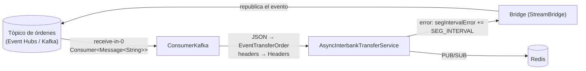
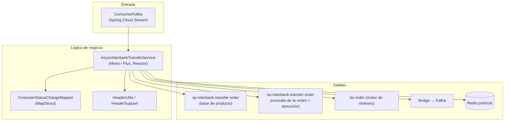
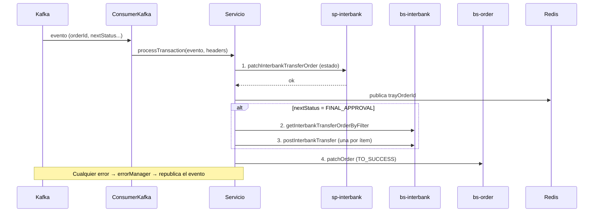

# async-interbank-transfer

Microservicio **consumidor de eventos** que ejecuta de forma asíncrona las **transferencias interbancarias** de una banca empresarial. Escucha un tópico de Kafka (Azure Event Hubs por su protocolo Kafka), actualiza el estado de la orden en varios servicios, ejecuta la transferencia y avisa por Redis. Los fallos se reintentan republicando el mismo evento en el tópico, con espera creciente.

| | |
|---|---|
| **Stack** | Java, Spring Boot (WebFlux / Reactor), Spring Cloud Stream (binder Kafka), Spring Data Redis reactivo, MapStruct, Lombok, Gson, clientes generados desde OpenAPI, Gradle |
| **Broker** | Azure Event Hubs con protocolo Kafka (`SASL_SSL`, `PLAIN`, puerto 9093) |
| **Rol en Kafka** | Consumidor y productor (reintentos) sobre el **mismo tópico** |
| **Tests** | JUnit 5 + Mockito en `src/test` (consumidor, bridge, servicio, mapper, utilidades) |

> Falta el `build.gradle`/`settings.gradle` en el árbol local. Las dependencias están inferidas del código.

## Qué hace sobre Kafka

| Elemento | Detalle |
|---|---|
| **Consumidor** | Bean `Consumer<Message<String>> receive()` en [`ConsumerKafka`](src/main/java/com/example/banking/services/service/stream/ConsumerKafka.java), activado con `spring.cloud.function.definition=receive`. El binding es `receive-in-0` |
| **Productor** | [`Bridge`](src/main/java/com/example/banking/services/service/stream/Bridge.java) usa `StreamBridge.send(...)` para republicar el evento ante un error |
| **Payload** | JSON deserializado con Gson a [`EventTransferOrder`](src/main/java/com/example/banking/services/dto/EventTransferOrder.java): `orderId`, `customerUserId`, `eventDate`, `status`, `nextStatus`, `channel`, `action`, `segIntervalError` |
| **Headers del mensaje** | `app-name`, `request-id`, `x-session`, `process-code`, `caller-name`, `x-device`, `x-device-ip`, `x-language`, `customer-user-id`, `customer-affiliation-id`. Se leen en `ConsumerKafka` y se reenvían a las APIs (ver [`HeaderUtils`](src/main/java/com/example/banking/services/utils/HeaderUtils.java)) |
| **Reintentos del binder** | `maxAttempts=3`, `backOffInitialInterval=500`, `backOffMaxInterval=1000`, `backOffMultiplier=2.0` |
| **Grupo de consumo** | `receive-in-0.group` (en el perfil local, `destination.group`) |
| **Seguridad** | `security.protocol=SASL_SSL`, `sasl.mechanism=PLAIN`, usuario `$ConnectionString` y la cadena de conexión del Event Hub como contraseña, **siempre por variable de entorno** |

### Reintento "casero" con espera creciente

El campo `segIntervalError` viaja **dentro del evento** y actúa como contador de espera:

1. Si es nulo se inicia en `SEG_INTERVAL_INIT`.
2. Si es menor que `SEG_INTERVAL_LIMIT`: el consumidor **duerme** esos segundos (`Thread.sleep`) y llama a `processTransaction`.
3. Si algún paso falla, `errorManager` suma `SEG_INTERVAL` y **republica** el evento con `Bridge`.
4. Si ya alcanzó el límite: se llama a `processErrorPatchOrder`, que marca la orden en error (`ERROR_LAST_STEP`, acción `TO_FAIL`).

## Arquitectura

Estructura por capas, con el consumidor como punto de entrada (no hay endpoints propios más allá de Actuator).

| Paquete (`com.example.banking.services`) | Responsabilidad |
|---|---|
| `service.stream` | Entrada y salida de Kafka (`ConsumerKafka`, `Bridge`) |
| `service` | Orquestación de la transferencia (`AsyncInterbankTransferService`) |
| `dto` | `EventTransferOrder`, `Headers`, `Message` (aviso a Redis) |
| `mapper` | MapStruct: evento → peticiones a las APIs |
| `utils` / `helper` | Headers, serializador JSON, constantes (`FINAL_APPROVAL`, `TO_SUCCESS`, `TO_FAIL`, `PENDING`) |
| `config` | `PropertiesConfiguration`: parámetros externos por `@Value` |
| `src/main/resources/openapi*.yaml` | Contratos OpenAPI de las APIs que consume; de ellos se **generan los clientes** (`client.*`) |

### Flujo de una orden (`processTransaction`)

Si `nextStatus` es `PENDING` se omite el paso 1; si no es `FINAL_APPROVAL` se omiten los pasos 2 y 3.

## Configuración

Los valores sensibles **no están en el repositorio**. Se inyectan por variables de entorno.

| Variable | Uso |
|---|---|
| `ENGINE_EVENTHUB_HOST`, `GENERIC_EVENTHUB_PORT` | Broker (Event Hubs) |
| `ENGINE_EVENTHUB_INTERBANK` | Nombre del tópico (entrada, salida y grupo) |
| `EH_DAC_ALL_LISTED_SEND` y la clave de acceso | Política y clave de Event Hubs |
| `GENERIC_REDIS_HOST`, `GENERIC_REDIS_PORT`, `GENERIC_REDIS_PASSWORD` | Redis (TLS) |
| `CLUSTER_PATH_SP_INTERBANK_TRANSFER_ORDER`, `CLUSTER_PATH_BS_INTERBANK_TRANSFER_ORDER`, `CLUSTER_PATH_BS_ORDER` | URLs base de las APIs |
| `SEG_INTERVAL`, `SEG_INTERVAL_LIMIT`, `SEG_INTERVAL_INIT` | Reintento con espera creciente |
| `EXECUTE_ORDER_PROCESS_CODE`, `MODIFY_ORDER_PROCESS_CODE`, `CLAIM_NAME`, ... | Códigos de proceso y canal de Redis |

Para desarrollo local, copiar [`application-local.properties.example`](src/main/resources/application-local.properties.example) a `application-local.properties` (ignorado por git) y definir `EVENTHUB_HOST`, `EVENTHUB_KEY_NAME`, `EVENTHUB_SHARED_ACCESS_KEY`, `REDIS_HOST` y `REDIS_PASSWORD` en el entorno.

## Cómo ejecutarlo

1. Reponer el `build.gradle` (Spring Boot WebFlux, Spring Cloud Stream Kafka, Spring Data Redis reactivo, MapStruct, Lombok, Gson, plugin de OpenAPI Generator).
2. Exportar las variables anteriores.
3. `./gradlew bootRun --args='--spring.profiles.active=local'` (puerto 8082 en local).
4. `./gradlew test`.

## Puntos a revisar

| Observación | Por qué importa |
|---|---|
| `Bridge` envía a `retryInterbank-out-0`, pero la configuración define `retry-out-0` | El binding del productor no coincide con la propiedad y el reenvío puede no ir al tópico esperado |
| `Thread.sleep` dentro del consumidor | Bloquea el hilo del consumidor y retrasa el resto de mensajes de la partición |
| Reintento republicando en el mismo tópico | Sin tope claro de orden ni DLQ; se pierde el orden por entidad |
| `subscribe()` sin gestionar errores ni confirmar el *offset* | El mensaje se da por consumido aunque el procesamiento reactivo falle después |
| Falta de idempotencia explícita | Un reintento tras un fallo parcial puede ejecutar dos veces la transferencia |
| `Headers.language` y `customerAffiliationId` se arman con `objectToString(HEADER_...)` (la constante, no el valor del header) | Se envía el nombre del header como valor |
