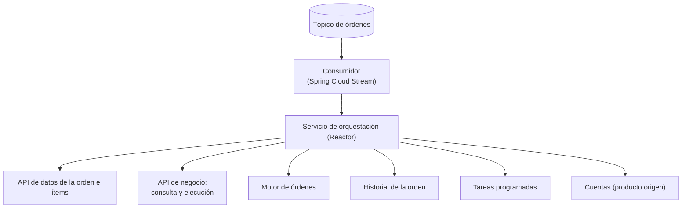
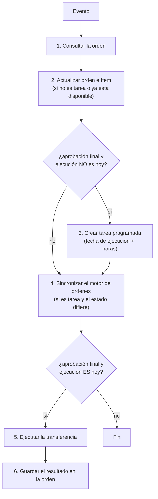

# Caso de estudio · Órdenes de transferencia al exterior asíncronas

> Documentación de **cómo se diseñó y qué problemas se resolvieron**. No incluye el código fuente: la implementación depende de un entorno concreto y envejece. Los fragmentos son ilustrativos.

## El problema

Una transferencia al exterior no siempre se ejecuta en el momento de aprobarla: el cliente puede programarla para **otra fecha**, puede tener **exención de impuestos** que se valida con un archivo, y el estado debe mantenerse coherente en varios sistemas (datos de producto, motor de órdenes e historial). Hacerlo todo en la petición del usuario sería lento y frágil.

**Solución:** un consumidor de eventos que reacciona a cada cambio de estado y decide qué hacer: actualizar, **programar una tarea** o **ejecutar**.

| | |
|---|---|
| **Rol** | Consumidor de eventos que orquesta la orden |
| **Stack** | Java, Spring Boot (WebFlux / Reactor), Spring Cloud Stream (binder Kafka), MapStruct, clientes HTTP generados desde OpenAPI |
| **Broker** | Azure Event Hubs usado con su **protocolo Kafka** (`SASL_SSL`, puerto 9093) |

## Arquitectura



El consumidor es la única entrada; no hay lógica de negocio en él, solo **normalización del evento**.

## Dos tipos de evento en el mismo tópico

El mismo tópico transporta dos cosas distintas, y el consumidor las distingue por un campo:

| Si el evento trae... | Es... | Qué hace el servicio |
|---|---|---|
| `eventCode` informado | Una **tarea programada** que vence | Actualiza a *disponible* y, si es el día, ejecuta |
| `eventCode` vacío | Un **cambio de estado** de la orden | Actualiza, y programa o ejecuta según la fecha |

Normalización previa en el consumidor:

- Si la acción es la de *spot*, se fuerza el estado siguiente a *disponible*.
- Si falta `customerUserId`, se genera un identificador para no romper los *headers*.

## Flujo de decisión



## Problemas que hubo que resolver

### 1. Órdenes programadas para otra fecha

**Problema:** la aprobación y la ejecución ocurren en días distintos.

**Solución:** al llegar a aprobación final, si la fecha de ejecución **no es hoy**, el servicio crea una **tarea programada** (fecha de ejecución más un desfase configurable en horas). Cuando la tarea vence, el sistema de tareas **vuelve a publicar un evento** con `eventCode`, y el mismo consumidor lo procesa como tarea y ejecuta. Es decir: el reloj vive en un componente especializado y Kafka solo transporta el aviso.

Detalle importante: se comparan fechas **sin hora** (se limpian las horas antes de comparar) para evitar que una diferencia de minutos mueva la orden de día.

### 2. Dos flujos de ejecución: normal y con exención

**Problema:** algunos clientes están exentos de un impuesto, y la exención se prueba con un archivo que se valida aparte.

**Solución:** al ejecutar se elige el flujo según el ítem:

| | Flujo normal | Flujo con exención |
|---|---|---|
| Condición | Por defecto | Exención habilitada **y** archivo validado con éxito |
| Acción de ejecución | *Iniciar* | *Aprobar* |
| Clave de usuario | Derivada de la bandeja | Referencia FX de la orden |
| Datos adicionales | Cliente exento = `false` | Cliente exento = `true` + código del documento |

La operación se identifica con **código de agencia + literal + número de orden a 8 dígitos**, lo que la hace trazable y única por orden.

### 3. Mantener varios sistemas coherentes

**Problema:** el estado vive en tres sitios (datos de producto, motor de órdenes, historial) y no hay transacción distribuida.

**Solución:** se actualiza en un orden fijo y **solo cuando hace falta**: el motor de órdenes se parchea únicamente si el estado del historial difiere del nuevo. Eso hace la operación casi idempotente y evita escrituras repetidas. Hoy lo reforzaría con una clave de idempotencia explícita.

### 4. Errores consistentes

El servicio expone un manejador de errores global con un **catálogo de códigos** (`SP01`, `SP02`, `SP03`...), cada uno con un mensaje para el desarrollador y otro para el usuario, y un resolvedor por tipo de excepción. Así los fallos de las APIs externas se traducen siempre al mismo formato.

### 5. Configuración sin secretos

Todo lo sensible y lo variable por ambiente (broker, política y clave de acceso, URLs de cada API, estados, acciones, códigos) entra por **variables de entorno**. Ver [Gestión de claves](../docs/gestion-de-claves.md).

## Configuración del consumidor (ilustrativa)

```properties
spring.cloud.function.definition=receive
spring.cloud.stream.bindings.receive-in-0.destination=${ORDERS_TOPIC}

spring.cloud.stream.bindings.receive-in-0.consumer.maxAttempts=3
spring.cloud.stream.bindings.receive-in-0.consumer.backOffInitialInterval=500
spring.cloud.stream.bindings.receive-in-0.consumer.backOffMultiplier=2.0

spring.cloud.stream.kafka.binder.brokers=${EVENTHUB_HOST}:9093
spring.cloud.stream.kafka.binder.configuration.security.protocol=SASL_SSL
spring.cloud.stream.kafka.binder.configuration.sasl.mechanism=PLAIN
```

## Lo que mejoraría hoy

| Tema | Mejora |
|---|---|
| `subscribe()` sin manejo de errores | Devolver el `Mono`, reintentar con tópicos por niveles y enviar a DLQ |
| `doOnSuccess` que lanza otra operación reactiva sin suscribirla | Encadenar con `flatMap` para que realmente se ejecute |
| Sin `group` en el binding | Definir un grupo para que las instancias se repartan la carga |
| Acceso al primer ítem con `get(0)` | Validar que la lista no esté vacía |
| Productor definido pero sin uso | Eliminarlo o usarlo para los reintentos |
| Librería de pruebas usada en código de producción (`Gson` de un paquete interno de Cucumber) | Usar la dependencia oficial |
| Autenticación | Microsoft Entra ID / identidad administrada |

## Qué aprendí

- **Un evento puede significar cosas distintas**: conviene un campo que lo distinga o tópicos separados.
- Delegar el **tiempo** a un componente de tareas programadas, y usar Kafka solo para avisar, simplifica el consumidor.
- Comparar solo la parte relevante de un dato (la fecha, sin hora) evita errores sutiles.
- Hacer las actualizaciones **condicionales** es una forma barata de acercarse a la idempotencia.
