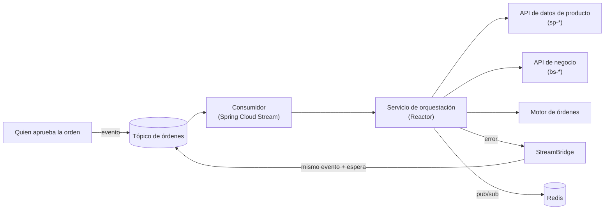
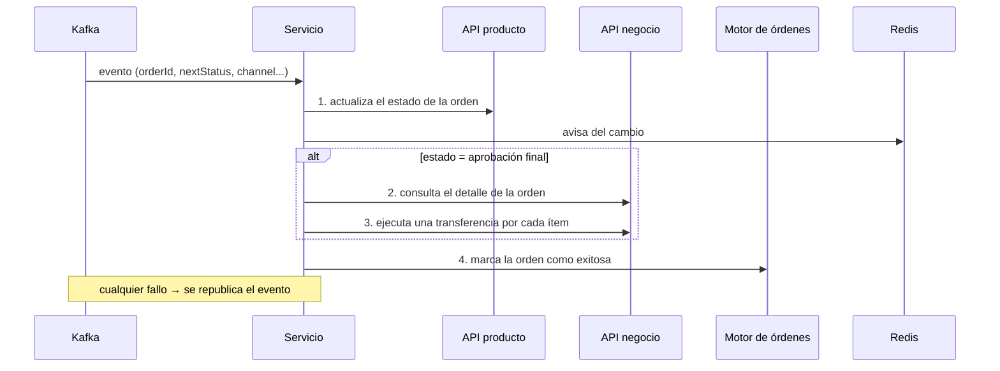
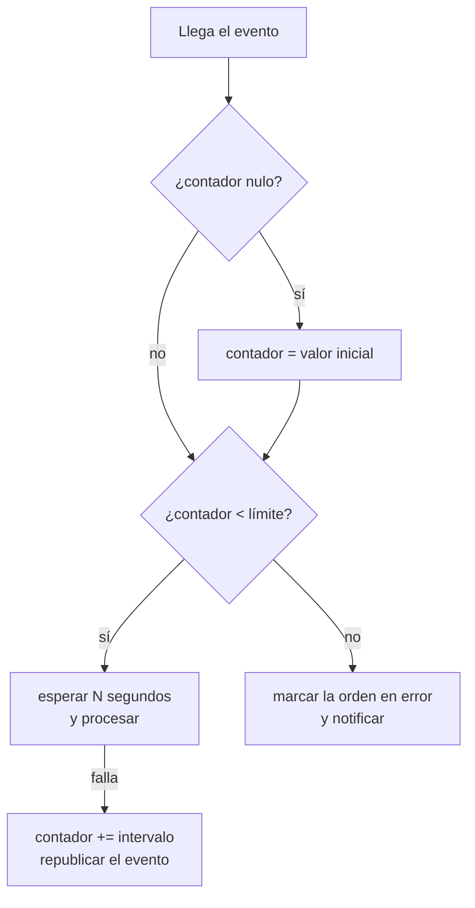

# Caso de estudio · Transferencias interbancarias asíncronas

> Documentación de **cómo se diseñó y qué problemas se resolvieron**. No incluye el código fuente: la implementación depende de un entorno concreto y envejece. Los fragmentos son ilustrativos y están escritos de cero.

## El problema

Una orden de transferencia interbancaria pasa por varias etapas de aprobación. Cuando llega a su estado final hay que **ejecutarla**, y eso implica llamar a varios servicios que pueden fallar de forma independiente. Hacerlo dentro de la petición del usuario es frágil: si un servicio tarda o cae, el usuario queda esperando o con la orden a medias.

**Solución:** desacoplar con un evento. Quien aprueba la orden publica un evento en Kafka y un servicio consumidor se encarga del resto, de forma asíncrona y con reintentos.

| | |
|---|---|
| **Rol** | Consumidor de eventos que orquesta la ejecución |
| **Stack** | Java, Spring Boot (WebFlux / Reactor), Spring Cloud Stream (binder Kafka), Spring Data Redis reactivo, MapStruct, clientes HTTP generados desde OpenAPI |
| **Broker** | Azure Event Hubs usado con su **protocolo Kafka** (`SASL_SSL`, puerto 9093) |

## Arquitectura



Capas, de fuera hacia dentro:

1. **Entrada (stream):** un bean `Consumer<Message<String>>` enlazado a un tópico por configuración. Solo deserializa y arma los *headers*.
2. **Orquestación:** un servicio reactivo que encadena las llamadas (`flatMap`) y decide qué pasos aplican según el estado.
3. **Salida:** clientes HTTP **generados desde los contratos OpenAPI** de cada API, para no escribir ni mantener a mano los DTO.
4. **Mapeo:** MapStruct convierte el evento a las peticiones de cada API.

## Cómo se ejecuta una orden



Cada paso se omite si no aplica: un estado `PENDING` no actualiza producto, y solo la aprobación final ejecuta la transferencia.

## Problemas que hubo que resolver

### 1. Reintentar sin perder el mensaje ni saturar al servicio caído

**Problema:** si un servicio externo falla, reintentar de inmediato solo lo empeora, y el reintento del binder (3 intentos cortos) no alcanza para una caída de segundos.

**Solución:** un **contador de espera dentro del propio evento** (`segIntervalError`):



Ventajas: no necesita infraestructura extra, el estado del reintento **viaja con el mensaje** y el límite es configurable. Desventajas (y qué mejoraría hoy): la espera con `Thread.sleep` bloquea el hilo del consumidor y retrasa los demás mensajes de la partición; republicar en el mismo tópico rompe el orden por entidad; no hay DLQ.

**Alternativa moderna:** tópicos de reintento por niveles (`retry-5s`, `retry-30s`) más una DLQ, que mueve la espera fuera del consumidor.

### 2. Trazabilidad entre servicios

**Problema:** una orden toca cuatro o cinco servicios; sin un identificador común es imposible reconstruir qué pasó.

**Solución:** un conjunto estándar de *headers* que viajan en el mensaje y se reenvían a cada API: `request-id`, `process-code`, `app-name`, `caller-name`, `x-session`, `x-device`, `x-language`, `customer-user-id`. Si el mensaje no trae `request-id`, el consumidor **genera uno** con prefijo para saber que se originó en el consumidor. Además, `request-id` y `process-code` se ponen en el **contexto de Reactor (MDC)**, para que cada línea de log lleve la misma correlación aunque cambie de hilo.

El `process-code` se elige según el estado: uno para ejecutar y otro para modificar. Así el servicio llamado sabe **por qué** se le llama.

### 3. Avisar a la interfaz sin que consulte constantemente

**Problema:** el usuario ve la bandeja de órdenes; cuando cambia el estado hay que refrescarla.

**Solución:** tras actualizar el estado se publica el identificador de la orden en un canal **pub/sub de Redis**, que la capa de presentación escucha. Es un aviso ligero, no la fuente de verdad.

### 4. Ejecutar varios ítems por orden

Una orden puede tener varios ítems. Se modelan como un `Flux` (uno por ítem) y se ejecuta una transferencia por cada uno. El mapeo desde el evento y el detalle de la orden hacia la petición se centraliza en el mapper, con valores por defecto (`Optional`) para tolerar datos incompletos.

### 5. Configuración sin secretos

Toda la configuración sensible entra por **variables de entorno** (host del broker, política y clave de acceso, URLs de las APIs, credenciales de Redis, parámetros de reintento). El mismo artefacto se despliega en cualquier ambiente. Ver [Gestión de claves](../docs/gestion-de-claves.md).

## Configuración del consumidor (ilustrativa)

```properties
# Función que consume
spring.cloud.function.definition=receive
spring.cloud.stream.bindings.receive-in-0.destination=${ORDERS_TOPIC}
spring.cloud.stream.bindings.receive-in-0.group=${CONSUMER_GROUP}

# Reintentos del binder (antes del reintento propio)
spring.cloud.stream.bindings.receive-in-0.consumer.maxAttempts=3
spring.cloud.stream.bindings.receive-in-0.consumer.backOffInitialInterval=500
spring.cloud.stream.bindings.receive-in-0.consumer.backOffMultiplier=2.0

# Event Hubs por su endpoint Kafka
spring.cloud.stream.kafka.binder.brokers=${EVENTHUB_HOST}:9093
spring.cloud.stream.kafka.binder.configuration.security.protocol=SASL_SSL
spring.cloud.stream.kafka.binder.configuration.sasl.mechanism=PLAIN
spring.cloud.stream.kafka.binder.configuration.sasl.jaas.config=\
  org.apache.kafka.common.security.plain.PlainLoginModule required \
  username="$ConnectionString" \
  password="Endpoint=sb://${EVENTHUB_HOST}/;SharedAccessKeyName=${EVENTHUB_KEY_NAME};SharedAccessKey=${EVENTHUB_SHARED_ACCESS_KEY}";
```

El *username* literal `$ConnectionString` es la convención de Event Hubs para autenticar con una cadena de conexión.

## Lo que mejoraría hoy

| Tema | Mejora |
|---|---|
| Espera con `Thread.sleep` | Tópicos de reintento por niveles + DLQ |
| `subscribe()` sin gestionar errores | Devolver el `Mono` y confirmar el *offset* solo al terminar |
| Idempotencia | Clave de idempotencia por orden e ítem; un reintento tras un fallo parcial hoy podría ejecutar dos veces |
| Orden por entidad | Usar la orden como **clave de partición** |
| Binding del productor | El nombre del binding usado en código debe coincidir con el de la configuración (hubo un desajuste) |
| Autenticación | Microsoft Entra ID / identidad administrada en lugar de claves compartidas |

## Qué aprendí

- Un **evento + consumidor idempotente** desacopla mejor que una llamada síncrona larga.
- El estado del reintento puede viajar en el mensaje, pero tiene un coste de orden y de bloqueo.
- Los *headers* de trazabilidad no son opcionales en una cadena de servicios.
- Generar los clientes desde OpenAPI evita derivas entre contratos y código.
