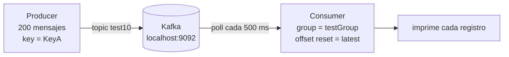

# Ejercicio 1 · Kafka con el cliente Java puro (`kafka-clients`)

El ejercicio más básico: un **productor** y un **consumidor** escritos directamente con la librería `kafka-clients`, sin Spring. Sirve para ver **qué hace Kafka por debajo** antes de que un framework lo esconda.

| | |
|---|---|
| **Stack** | Java, Gradle, `kafka-clients 3.2.0`, JUnit 5 |
| **Broker** | `localhost:9092` |
| **Topic** | `test10` |
| **Clases** | [`Producer.java`](src/main/java/ec/com/example/Producer.java), [`Consumer.java`](src/main/java/ec/com/example/Consumer.java) |

## 🍎 Con manzanas

Kafka es el **libro de ventas** de una frutería. El `Producer` es la **caja** que anota 200 ventas de golpe (todas del cliente "KeyA"). El `Consumer` es **contabilidad**: se sienta a leer el libro desde donde se quedó su marcador y va imprimiendo lo nuevo. El **grupo** (`testGroup`) es el equipo de contabilidad: si llega otro contador del mismo equipo, se reparten las secciones del libro.

## Qué hace el código

**Productor** (`Producer.java`)
- Configura `bootstrap.servers`, y `StringSerializer` para la **key** y el **value**.
- Envía **200 mensajes** al topic `test10`, todos con la misma key `"KeyA"` y el contador como valor.
- Termina con `flush()` y `close()`.

**Consumidor** (`Consumer.java`)
- Configura `bootstrap.servers`, `StringDeserializer`, `group.id = testGroup` y `auto.offset.reset = latest`.
- Se suscribe a `test10` y hace `poll(500 ms)` en un bucle, imprimiendo cada registro.

## Conceptos que demuestra

| Concepto | Dónde se ve |
|---|---|
| **Topic, key, value** | `ProducerRecord("test10", "KeyA", valor)` |
| **Partición por key** | Todas las ventas tienen la misma key, así que van a **la misma partición** y llegan **en orden** |
| **Serialización** | `StringSerializer` / `StringDeserializer` |
| **Consumer group** | `group.id = testGroup` |
| **Offsets y `auto.offset.reset`** | `latest`: un grupo nuevo solo ve lo que llegue **después** de arrancar |
| **Pull** | El consumidor **pide** datos con `poll`, Kafka no se los empuja |

## Cómo ejecutarlo

1. Levanta un Kafka local en `localhost:9092` (por ejemplo con Docker o el binario oficial).
2. Arranca primero el `Consumer` (con `latest`, si arrancas el productor antes **no verás nada**).
3. Arranca el `Producer`.

## Cosas que se pueden mejorar (y que sirven para explicar en la entrevista)

| Observación | Por qué importa | Cómo se corrige |
|---|---|---|
| El bucle del consumidor es `while (count < 100)` pero `count` **nunca se incrementa** | Es un bucle infinito, y el consumidor nunca se cierra | `while (true)` con `consumer.wakeup()` en un shutdown hook, y cerrar en `finally` o con *try-with-resources* |
| `producer.send(...)` sin callback | No te enteras si un envío falla | `send(record, (metadata, ex) -> ...)` y revisar el error |
| No se configuran `acks` ni idempotencia | Con `acks=1` puedes perder datos si cae el líder | `acks=all` y `enable.idempotence=true` (en clientes recientes la idempotencia ya viene activa por defecto) |
| Una sola key para todo | **Toda la carga cae en una partición**: en un grupo con varios consumidores solo uno trabaja | Usar varias keys (id de cuenta, de pedido) |
| El commit es automático (por defecto) | Puedes confirmar mensajes que luego no procesas bien | `enable.auto.commit=false` y `commitSync()` **después** de procesar |

## Experimentos para practicar

1. Arranca **dos consumidores con el mismo `group.id`** y manda mensajes con **keys distintas**: ¿se reparten? (necesita más de una partición).
2. Cambia `latest` por `earliest` con un `group.id` nuevo: ¿qué lees?
3. Crea el topic con **3 particiones** y observa `record.partition()` y `record.offset()` en la salida.
4. Mata un consumidor del grupo y mira el **rebalanceo**.

## Cómo explicarlo en una entrevista

> "Hice una prueba de concepto con el cliente Java de Kafka: un productor que envía mensajes con key al topic, y un consumidor en un grupo que los lee con `poll`. Con la misma key los mensajes van a la misma partición y conservan el orden. Para producción añadiría `acks=all`, idempotencia, commit manual después de procesar y un consumidor idempotente."

## Relacionado en el repo de estudio

[`software-engineering/messaging-streaming/kafka.md`](https://github.com/edzamo/software-engineering) · conceptos de particiones, grupos, offsets y garantías de entrega.
